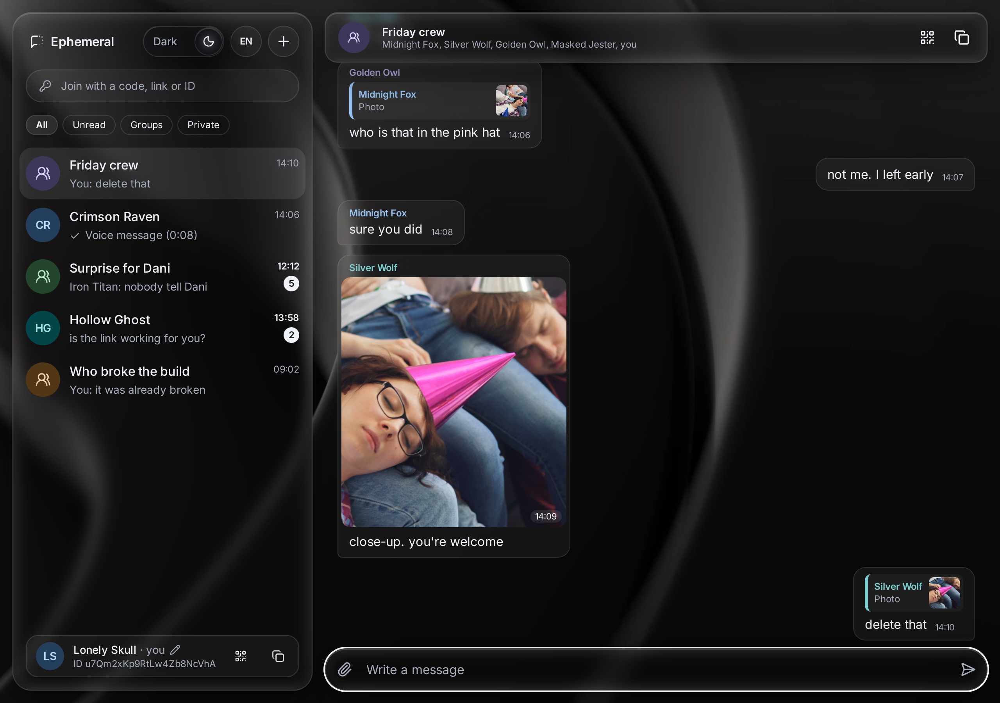
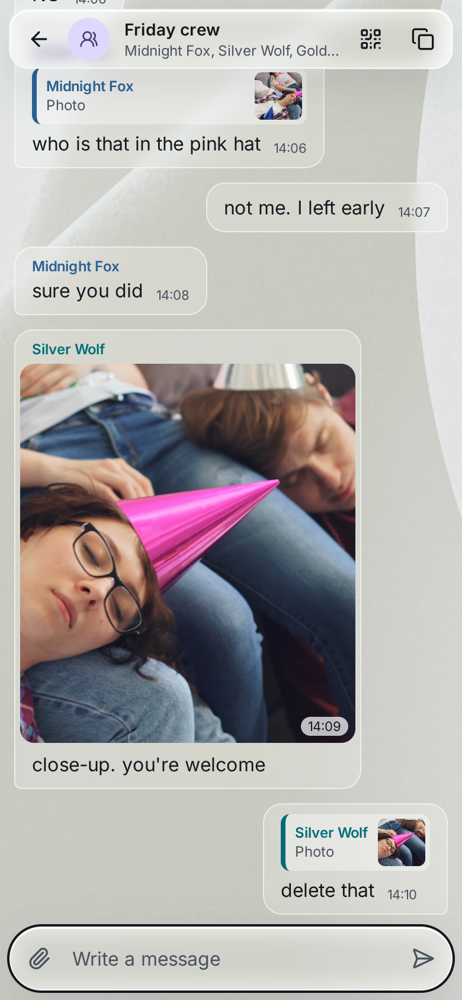
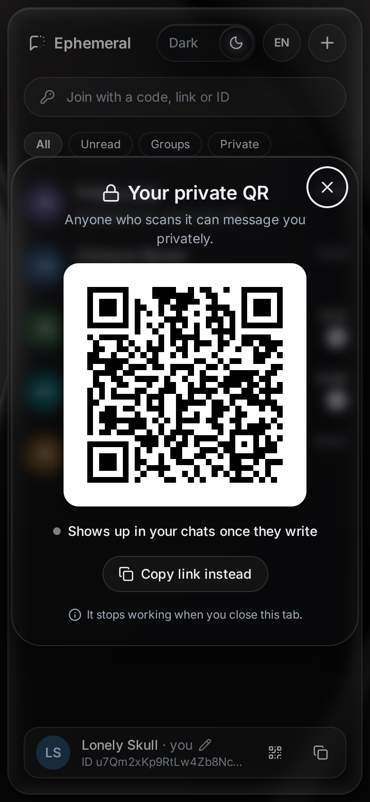

<p align="center">
  <picture>
    <source media="(prefers-color-scheme: dark)" srcset="./docs/images/logo-dark.svg">
    
  </picture>
</p>

<h1 align="center">Ephemeral Chat</h1>

<p align="center">
  A real-time chat where <strong>nothing is kept</strong>.<br>
  No accounts, no database, no history. You come in, talk, and when everyone leaves, the conversation is gone.
</p>

<p align="center">
  <strong>Try it:</strong> <a href="https://ephemeral-chat-9f8t.onrender.com">ephemeral-chat-9f8t.onrender.com</a>
</p>

<p align="center">
  <a href="./LICENSE"></a>
  <a href="https://github.com/esteban-abanto-2709/ephemeral-chat/actions/workflows/ci.yml"></a>
</p>

<p align="center">
  <a href="https://angular.dev"></a>
  <a href="https://tailwindcss.com"></a>
  <a href="https://go.dev"></a>
  <a href="https://www.typescriptlang.org"></a>
  <a href="./apps/docker/README.md"></a>
</p>

<p align="center">
  
</p>

---

## The idea

Most chats remember everything: every message, forever, tied to an account.

Ephemeral Chat starts from the opposite idea: **a conversation only exists
while people are in it**. Everything lives in the server's memory. There is
nothing to sign up for and nothing left behind.

## How it works

1. **Come in.** Your tab gets a generated nickname, like "Silver Wolf", and an
   id that lasts until you close it. Change the name anytime from your card.
2. **Create a group** and share its link or code. Whoever has it comes in,
   even if a friend forwarded it.
3. **Or invite someone** with your link or id: they get a private chat with
   you, and you hear from them with their first message.
4. **Talk** in several chats at once, like WhatsApp Web.
5. **Leave.** A minute after the last person goes, a group is gone and its
   link stops working; a private chat ends when either of you leaves.

The server **never stores a message**: it only passes it on to whoever is in
the chat at that moment. Join late and you see nothing from before. Reload and
everything you had is gone.

<p align="center">
  
  &nbsp;&nbsp;
  
</p>

## What it is NOT

- **Not a public chat.** There's no global room: every conversation happens
  behind a link.
- **Not a place to keep things.** No history, no accounts, nothing to recover.

## Status

**v0.8**: the journey above, deployed: you come in with a generated nickname
you can change, then groups and private chats in one page, with photos, files,
voice messages and replies, clickable links, QR codes and the whole page in
English and Spanish, over a glass design in light and dark. In a private chat
your messages show one check when sent and two once read. End-to-end
encryption is an idea for a later version. It is a demo, so expect rough
edges: today, locking your phone ends your chats.

The detail and the order are in the [roadmap](./docs/logbook/roadmap.md).

## How it's built

Two independent applications and the orchestration that ties them together:

| Folder | What it is |
|---|---|
| [`apps/web`](./apps/web/README.md) | The interface: Angular and Tailwind |
| [`apps/api`](./apps/api/README.md) | The server: Go, standard library |
| [`apps/docker`](./apps/docker/README.md) | One Docker image with both, as it runs in production |

In production a single container does everything: the Go server answers the
API under `/api/` and serves the interface for every other path.

Each folder has its own README with the technical detail.

### Run it on your machine

```bash
cd apps/docker
docker compose up -d --build
```

Then open `http://localhost:3000`.

## About the project

- [Product vision](./docs/product-vision.md): principles, limits, versions and
  what was decided against.
- [Logbook](./docs/logbook/): roadmap, ideas, technical debt and changelog.

## Contributing

Ideas and questions go to [Discussions](https://github.com/esteban-abanto-2709/ephemeral-chat/discussions),
where everything is open to debate. Bugs go to issues, and a pull request
needs an issue where we agreed on the change first: see
[CONTRIBUTING.md](./CONTRIBUTING.md).

## License

[MIT](./LICENSE) © Esteban Abanto
